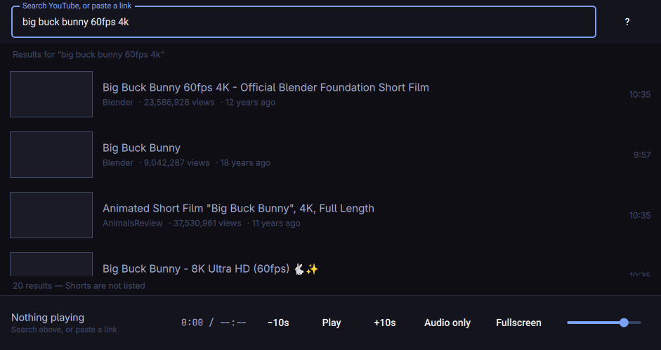

# hurutube

A small YouTube player: search, watch, and no Shorts. The video plays in mpv with
GPU decode (VA-API); the window is the browser and the remote control, and it
follows the desktop theme.



## Running it

```bash
bin/build        # cmake + make into build/hurutube
bin/test         # the Qt Test binary, offscreen
./build/hurutube # the player

./build/hurutube "kdenlive tutorial"                 # open with results
./build/hurutube https://youtu.be/aqz-KE-bpKQ        # play a link straight away
./build/hurutube @LinusTechTips                      # list a channel's videos
./build/hurutube --audio-only "lofi hip hop"         # no video window
./build/hurutube --search "kdenlive" --no-window --json   # headless, for scripts
./build/hurutube --history                            # what was watched, with positions
./build/hurutube --status                            # mpv, yt-dlp, the VA-API profiles here
```

On Hurunagus it comes from its own COPR (`wegweg7979/hurutube`), so there is
nothing to build there.

## Shorts

Blocked, and not by guessing. YouTube's own search API returns Shorts in a
renderer of their own, so they are never read into the list at all — one real
reply for a single query carried 12 videos and 30 Shorts. A `/shorts/` link is
refused by name instead of played, and a channel listing comes from its `/videos`
tab, which carries none either. Nothing is filtered by duration, so a genuinely
short video is still a video.

## Keys

| Key | What it does |
| :-- | :-- |
| `/` or `Ctrl+L` | focus the search box |
| `Enter` | search, or open a pasted link, or play the highlighted row |
| `↑` `↓` | move through the list |
| `Space` | pause or resume |
| `←` `→` | jump ten seconds |
| `R` | start the current video again |
| `A` | audio only (no video window) |
| `F` | fullscreen |
| `Ctrl+H` | what you have watched; Enter resumes, Delete forgets |
| `?` | every key, in the window |
| `Q` | quit |

Closing mpv's window stops the video and leaves the app where it was; the
position is remembered, so playing it again resumes.

## How it is put together

- **Search** is YouTube's inner API, one POST, well under a second — and it is
  where the Shorts block comes from, because that reply keeps Shorts in their own
  renderer. Channels and playlists go through `yt-dlp` instead: the inner browse
  endpoint answers an anonymous client with a header and nothing else.
- **Playback** is mpv over its JSON IPC socket, with `--hwdec=vaapi`. mpv owns
  the video window; embedding it would mean linking libmpv and sharing the Qt
  Quick scene graph for a window you watch full screen anyway.
- **The selected row is pre-resolved** while you are still reading the list
  (`yt-dlp -g`), and mpv is given the two direct URLs. Measured on studiobox2:
  **0.7–1.8 s** to the first frame that way, against **~18 s** for a cold resolve
  inside the playback path.
- **What is remembered** is one JSON file, `~/.local/state/hurutube/history.json`,
  written atomically, capped, and holding a position only when resuming makes
  sense (not for two seconds in, not for a video watched to the end). Settings —
  just `cookies_file` / `cookies_from` — are read from
  `~/.config/hurutube/config.toml`; cookies matter only for restricted videos.

Requires `mpv`, `yt-dlp` and Qt 6 (qt6-qtdeclarative); a JS runtime for yt-dlp is
recommended, since extraction degrades without one.
